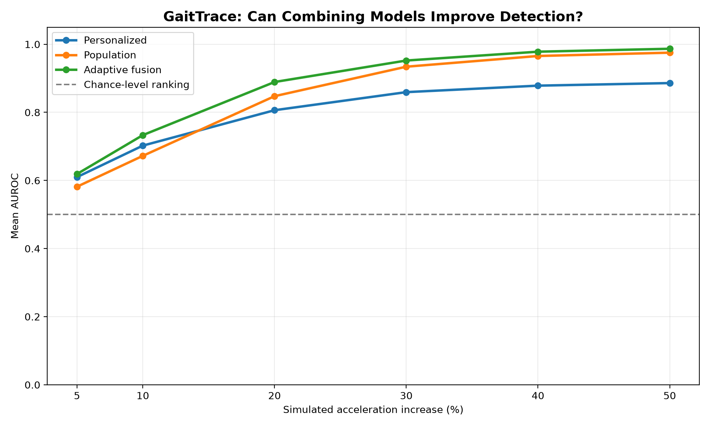
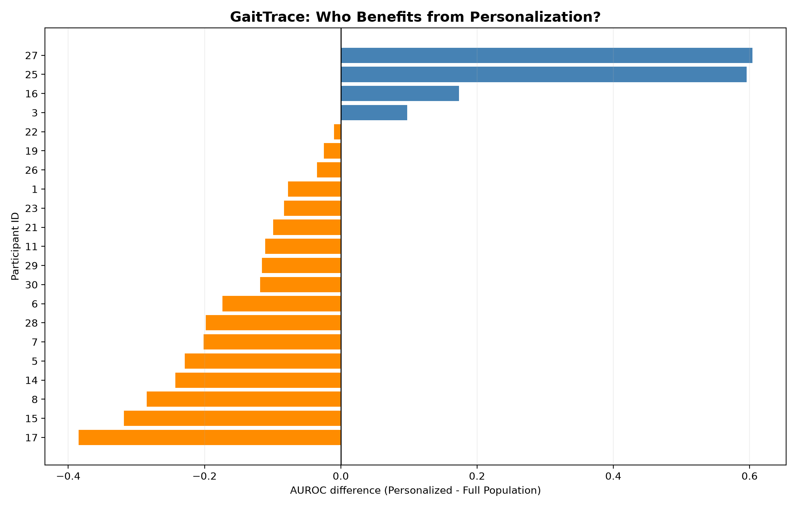
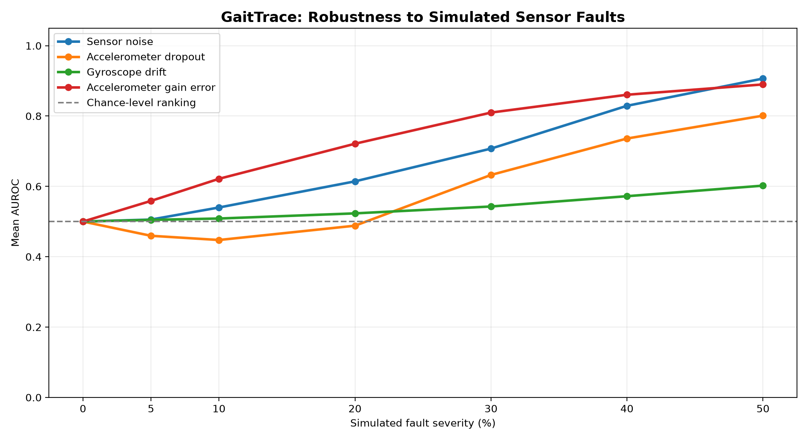
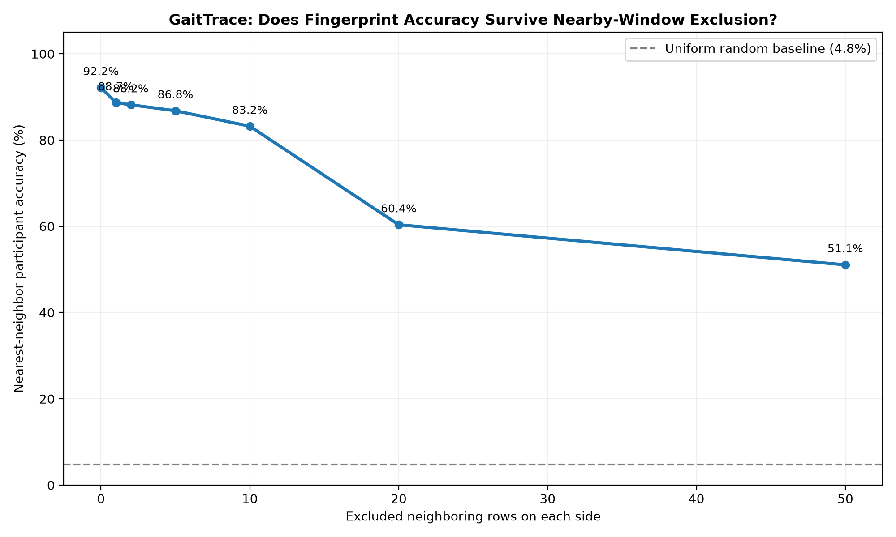

# GaitTrace
### Personalized AI-Powered Gait Monitoring

**GaitTrace** is a machine learning research prototype that explores how personalized and population-based AI models can identify unusual patterns in walking sensor data.

Inspired by my mom's experience with multiple sclerosis (MS), I wanted to investigate whether AI could learn how an individual normally walks and recognize changes in their movement.

**The research question:** Is it better to learn someone's walking patterns individually, from a population, or from both?

After evaluating **21 participants**, I discovered that neither personalized nor population-based models were consistently best for everyone. I then developed a **hybrid anomaly detector** combining both approaches, which achieved higher average AUROC than either standalone model across all six tested levels of simulated acceleration change.

## Key Result: Hybrid Anomaly Detection

The hybrid model combines personalized and population anomaly scores using a fixed 50/50 weighting, with scores normalized using separate validation data.

At a 50% simulated acceleration increase, it achieved **0.987 mean AUROC**, compared with 0.975 for the population model and 0.886 for the personalized model.



| Simulated acceleration change | Personalized | Population | Hybrid |
|---|---:|---:|---:|
| 5% | 0.610 | 0.582 | **0.619** |
| 10% | 0.702 | 0.672 | **0.733** |
| 20% | 0.806 | 0.847 | **0.889** |
| 30% | 0.859 | 0.934 | **0.952** |
| 40% | 0.878 | 0.966 | **0.978** |
| 50% | 0.886 | 0.975 | **0.987** |

*Mean AUROC across 21 participants. These results measure discrimination of artificially modified recordings, not real-world gait abnormalities.*

Participant-level bootstrap analysis found stronger evidence of hybrid improvement over the population model at 5–10% changes. Improvements at larger changes were less certain.

## How It Works

GaitTrace uses accelerometer and gyroscope recordings from the [UCI Human Activity Recognition dataset](https://archive.ics.uci.edu/dataset/240/human+activity+recognition+using+smartphones).

Each walking window contains 2.56 seconds of six-axis sensor measurements. The system extracts **24 statistical features**, including signal means, standard deviations, RMS values, and ranges.

Three approaches are compared:

- **Personalized model:** Isolation Forest trained on one participant's walking recordings.
- **Population model:** Isolation Forest trained on walking data from other participants.
- **Hybrid model:** Combines the normalized anomaly scores from both models.

Experiments use separate training, validation, and held-out test windows, with controlled modifications to acceleration, rotation, and sensor readings.

## Experiments & Discoveries

| Experiment | Key discovery |
|---|---|
| Personalized baseline | Initially detected simulated changes effectively for one participant, but this did not generalize to everyone. |
| Multi-participant evaluation | Across 21 participants, population models were often more sensitive to larger acceleration changes. |
| Perturbation sensitivity | Results varied depending on the type and magnitude of simulated movement changes. |
| Training-size controls | Population models retained an advantage even when trained on the same number of windows as personalized models. |
| AUROC evaluation | Population models generally achieved better separation for larger changes, independent of a single alert threshold. |
| Participant-level analysis | The best-performing model varied substantially between participants. |
| Hybrid score fusion | Combining personalized and population scores produced the highest mean AUROC at every tested acceleration-change level. |
| Statistical reliability | Hybrid improvements were more consistently positive at smaller simulated changes than at larger ones. |
| Sensor ablation | Accelerometer and gyroscope information contributed differently depending on the type of change. |
| Sensor sabotage | Gradual gyroscope drift was harder to distinguish from normal recordings than noise or gain errors. |
| False-alarm calibration | Target false-alarm rates did not reliably transfer to held-out walking windows. |
| Gait fingerprint study | Walking features showed participant-specific structure, with limitations caused by overlapping windows. |
| Window-overlap investigation | Excluding nearby recordings reduced apparent participant-identification accuracy considerably. |

### What Surprised Me

**1. Personalization isn't automatically better.**

At a 20% simulated acceleration increase, Participant 27 achieved 0.979 AUROC using the personalized model versus 0.375 with the population model. For Participant 17, the population model achieved 0.976 versus 0.592 personalized.



**2. More sensors don't always improve detection.**

At a 20% simulated rotation increase, the gyroscope-only hybrid achieved **0.897 AUROC**, outperforming the combined-sensor hybrid's 0.838. However, combining sensors performed best when both acceleration and rotation were modified (0.935 AUROC).

**3. Sensor failure can resemble movement changes.**

In simulated sensor-fault tests, the hybrid model achieved 0.907 AUROC for substantial sensor noise but only **0.602 for gradual gyroscope drift** at the highest tested settings. This suggests that wearable monitoring would need separate sensor-health checks.



**4. False-alarm thresholds are difficult to calibrate.**

At a 5% target false-alarm budget and 20% acceleration increase, the hybrid model detected 46.2% of modified recordings, with an observed 7.6% false-alarm rate on unchanged test windows.

**5. A high accuracy number can be misleading.**

My gait fingerprint experiment initially achieved **92.2% nearest-neighbor participant accuracy** across 1,226 walking windows.

But UCI HAR contains overlapping windows. When I excluded nearby recordings as potential nearest-neighbor matches, accuracy declined:

| Neighboring rows excluded | Accuracy |
|---|---:|
| 0 | 92.2% |
| ±10 | 83.2% |
| ±20 | 60.4% |
| ±50 | 51.1% |

This showed that the original fingerprint accuracy was partly influenced by nearby, highly similar windows.



## Tech Stack

**Python · NumPy · pandas · scikit-learn · Matplotlib · Streamlit · Plotly**

## Run Locally

Clone the repository and install dependencies:

```bash
git clone https://github.com/addiekochanik-main/gaittrace.git
cd gaittrace
python3 -m venv .venv
source .venv/bin/activate
pip install -r requirements.txt
```

Download the [UCI HAR dataset](https://archive.ics.uci.edu/dataset/240/human+activity+recognition+using+smartphones) and extract it into:

```text
data/UCI HAR Dataset/
```

Run the main experiments from the project root:

```bash
python src/adaptive_model.py
python src/statistical_analysis.py
python src/sensor_ablation.py
python src/sensor_sabotage.py
python src/false_alarm_study.py
python src/fingerprint_study.py
python src/fingerprint_leakage_test.py
```

Additional comparison and sensitivity experiments are available in `src/`. Generated graphs and detailed CSV results are saved in `results/`.

## Limitations & Next Steps

**GaitTrace is currently a research prototype**

The dataset contains smartphone recordings of everyday activities, not longitudinal clinical gait measurements. Artificial signal perturbations are not equivalent to real neurological gait changes, and overlapping walking windows limit the independence of the evaluation.

The hybrid uses fixed weights, and its results require further validation on independent walking sessions and wearable recordings.

Next steps includ collecting motion data using an **Arduino Nano ESP32 wearable**, and investigating adaptive models that can adjust to an individual's movement patterns over time.

## About the Project

Built solo during **Horowitz Andreessen Academy SideQuest Sundays!!**.

GaitTrace developed from a personalized anomaly-detection baseline into a multi-participant experimental pipeline, a hybrid model, and a series of investigations into model reliability, sensor selection, and evaluation bias.

**Main takeaway:** Personalized and population-based models have different strengths. Combining their scores improved average discrimination of simulated sensor changes, but understanding when results are reliable is just as important as improving performance.

---

*GaitTrace — Exploring personalized movement monitoring through machine learning.*